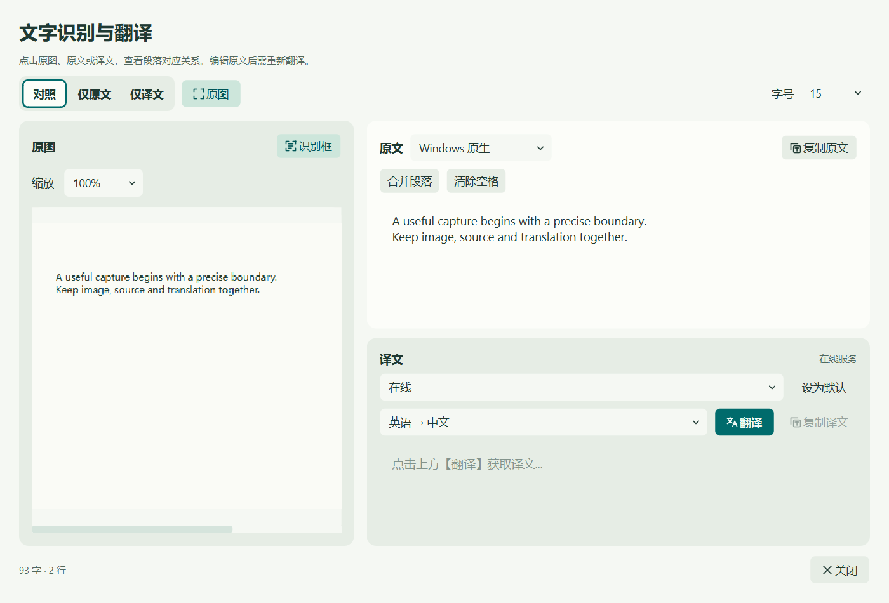
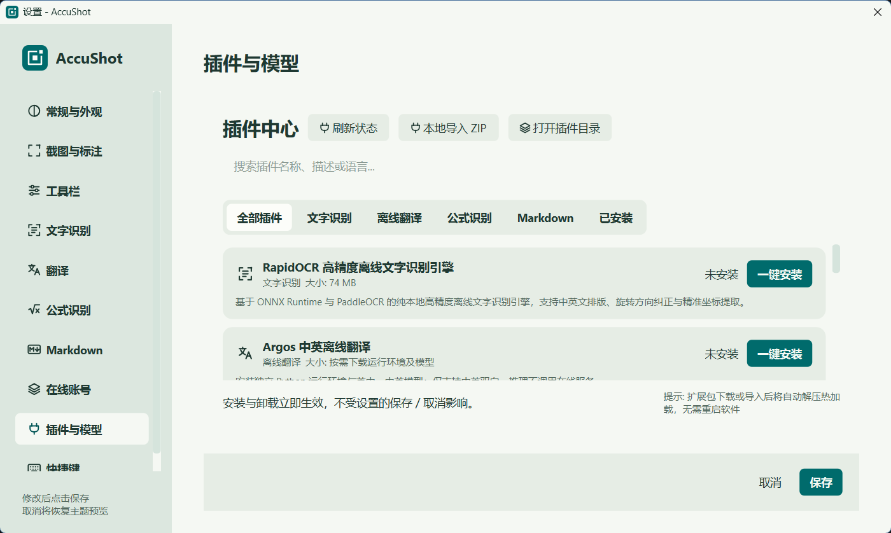
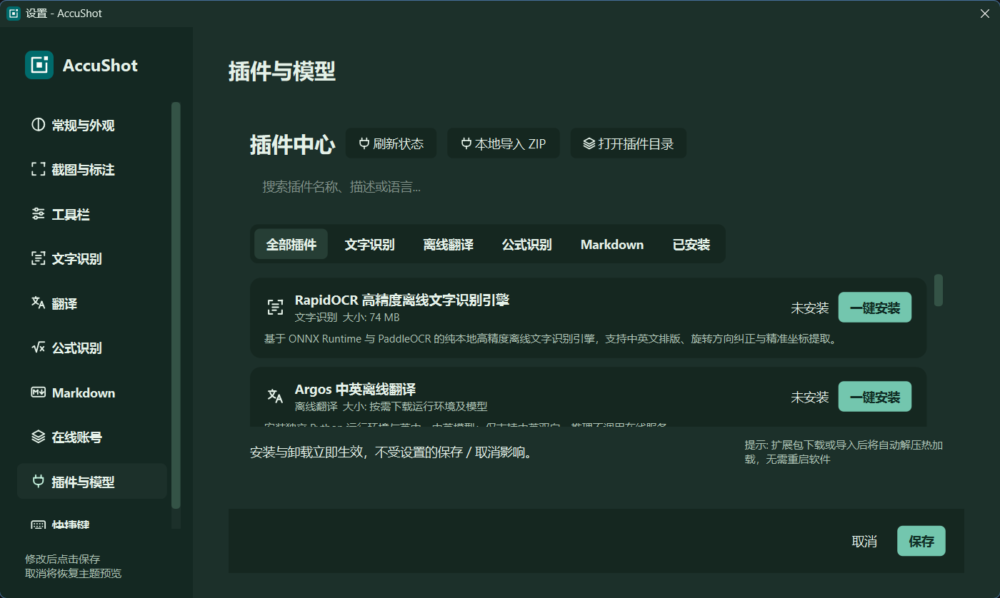

<div align="center">


# AccuShot

**框准所需，读懂所截。**

面向 Windows 的截图与内容提取工具。<br>
从精细选框，到文字、翻译、公式与 Markdown，让屏幕里的内容继续可用。


[](LICENSE)


[下载便携版](#download) · [功能亮点](#features) · [快速上手](#quick-start) · [快捷键](#shortcuts) · [源码构建](#build) · [参与贡献](#contributing)

<picture>
  <source media="(prefers-color-scheme: dark)" srcset="docs/images/readme/workbench-dark.png">
  
</picture>

<sub>原生 Qt 界面，使用示例文本展示。支持浅色、深色及跟随系统主题。</sub>

</div>

<a id="download"></a>

## 下载与运行

**[下载 AccuShot v1.2.1 · Windows x64 便携版](https://github.com/kongyouether/AccuShot/releases/download/v1.2.1/AccuShot-v1.2.1-windows-x64-portable.zip)**

[查看 Release 与更新说明](https://github.com/kongyouether/AccuShot/releases/tag/v1.2.1) · [下载 SHA256 校验文件](https://github.com/kongyouether/AccuShot/releases/download/v1.2.1/SHA256SUMS.txt)

1. 下载 ZIP，**完整解压**到有写入权限的目录。
2. 双击 `AccuShot.exe`，在任务栏右下角托盘找到程序。
3. 按 `F1` 开始截图；右键托盘可打开设置或退出。

便携包包含主程序、Qt 与 VC++ 运行库、中文使用说明及第三方许可材料。基础截图、标注和贴图不需要另装 Qt、Visual Studio 或 Python；请保留 EXE 旁的 DLL 和插件目录，不要只复制 EXE。

AI 模型不随包提供，可在设置中按需安装；部分本地插件需要 Python 3.12，在线能力需要自行配置账号。当前包在 Windows 11 x64 上完成构建和运行依赖验证，尚未在另一台干净电脑上完成全功能验收。

> “便携”表示免安装、解压运行。设置仍保存在 Windows 当前用户配置中，日志位于 `%LOCALAPPDATA%\AccuShot\AccuShot\logs`；首次运行默认开启自启动，可在设置中关闭。更新前请从托盘退出旧版本。

> 从 v1.2.0 升级时，请先记录需要保留的设置、关闭旧版自启动并退出。v1.2.1 不自动读取旧品牌配置，需要重新配置账号；已经使用 AccuShot 标识的设置与凭据继续保留。详见[项目标识与升级说明](docs/brand-identity.md)。

<details>
<summary>核对下载文件的 SHA256</summary>

下载 ZIP 和 `SHA256SUMS.txt` 到同一文件夹，在 PowerShell 中执行：

```powershell
Get-FileHash .\AccuShot-v1.2.1-windows-x64-portable.zip -Algorithm SHA256
Get-Content .\SHA256SUMS.txt
```

两处摘要应相同，大小写不影响比较。

</details>

<a id="features"></a>

## 功能亮点

### 让选框更接近你的意图

面对网页卡片、文档段落或层叠窗口，先让候选框找到范围，再用滚轮和微调确定边界。

- **四种吸附模式**：窗口、元素与控件、图像轮廓，以及结合三者的智能融合（默认）。
- **可见内容优先**：根据窗口层叠关系调整推荐次序；被遮挡、跨窗口的候选降级保留，仍可手动选择。
- **滚轮切换大小，Tab 切换推荐**：从小块内容到完整窗口，再到全屏，保留不同层级的选择空间。
- **Ctrl + 滚轮精细调整**：逐步扩大或缩小候选框，默认每档四边各移动 1 个逻辑像素，步长与快捷键可配置。
- **随时自由框选**：直接拖拽确定选区，也可以在设置中关闭自动吸附。

### 原图、原文、译文，放在一起核对

识别后无需来回切换多个窗口。点击原图中的文字行、选择原文或选择译文，即可联动定位对应段落。

- 支持图片缩放、识别框显示、原文编辑、合并段落、清除空格与复制。
- 提供对照、仅原文、仅译文视图，按任务调整阅读空间。
- 编辑原文后提示重新翻译，避免沿用已经失效的段落对应关系。
- **原位屏幕翻译**可在截图原位置展示译文，按住 `Space` 临时查看原图。

> 图文联动依赖 OCR 引擎提供文字坐标；在线纯文本识别不提供图片定位。译文联动按段落对应，不是逐词对齐。原位翻译针对单次截图，不会持续监听屏幕。

### 从截图直接进入笔记与写作

| 想做什么 | AccuShot 提供什么 |
|---|---|
| 提取屏幕文字 | Windows 原生 OCR、可选 RapidOCR，以及配置的在线识别服务 |
| 阅读外语内容 | 识别后翻译、原图/原文/译文联动、原位屏幕翻译 |
| 摘录论文公式 | 公式识别、LaTeX 编辑，复制 LaTeX、块级 Markdown 或 MathML |
| 整理截图笔记 | 截图转 Markdown，编辑源码、预览并导出 |
| 截取长页面或宽表格 | 纵向、横向滚动截图与拼接预览 |
| 记录操作过程 | 区域 GIF 录制 |
| 对照资料或反馈问题 | 桌面置顶贴图、矩形/箭头/画笔/文字/马赛克标注 |

<p align="center">
  
</p>

### 本地与在线，按功能各自选择

文字识别、翻译、公式识别和 Markdown 可以分别选择处理方案、模型与指令；在线账号共用服务配置，各功能保留自己的选择。

| 功能 | 本地方案 | 在线方案 |
|---|---|---|
| 文字识别 | Windows OCR；RapidOCR 插件 | 配置支持图片输入的识别服务 |
| 翻译 | Argos 中英双向翻译插件 | 配置的文本翻译服务 |
| 公式识别 | RapidLaTeXOCR、Pix2Text MFR、PP-FormulaNet 插件 | 配置的公式或视觉服务 |
| Markdown | RapidOCR 基础文本；Pix2Text 页面解析（实验） | 兼容视觉服务；Mathpix 适配插件 |

模型按需安装，基础截图、标注和贴图不需要安装 AI 模型。部分本地插件使用独立 Python 环境；安装可能需要下载运行依赖和模型，准备完成后可在本地推理。

<details>
<summary><strong>查看插件管理与深浅主题</strong></summary>

| 浅色 | 深色 |
|---|---|
|  |  |

截图来自实际 Windows 界面，展示未安装插件时的状态。

</details>

<a id="quick-start"></a>

## 快速上手

可直接使用上方的 [Windows x64 便携版](#download)，也可按下方步骤从源码构建。运行目录需同时包含 Qt 动态库和平台插件，不能只复制一个 EXE。

1. **启动 `AccuShot.exe`**，程序常驻系统托盘；右键托盘图标进入设置。
2. **按 `F1` 开始截图**，移动鼠标查看候选框，用滚轮切换大小，或直接拖拽框选。
3. **按 `Enter` 复制截图**，按 `F3` 将选区贴到桌面，或从工具栏选择标注、识别、翻译等操作。
4. **配置识别能力**：Windows OCR 为系统内置方案；其他本地方案先在「设置 → 插件与模型」安装所需插件，再到文字识别、翻译、公式识别或 Markdown 页选择。
5. **需要在线处理时**，先在「设置 → 在线账号」配置服务地址和密钥，再在对应功能页选择模型。图片任务还需服务与模型支持图片输入。

新配置默认使用「智能融合」，结合窗口、元素与图像轮廓生成候选框。已经保存的吸附模式会继续保留，可在「设置 → 截图与标注」中切换。

### 数据如何处理

- 基础截图、标注、贴图，以及已安装的本地识别/翻译方案在本机处理内容。
- 选择在线方案后，执行相应功能会向所配置的服务发送文字或图片；服务可能收费，具体以供应商规则为准。
- 在线账号的 API 密钥通过 Windows 凭据管理器保存。模型、账号和密钥不随源码提供。
- 本地插件安装阶段可能联网下载；“本地推理”不等于“安装过程无需联网”。

<a id="shortcuts"></a>

## 常用快捷键

以下为默认映射，截图相关快捷键和滚轮方向可在设置中调整。

| 场景 | 操作 | 默认按键 |
|---|---|---|
| 全局 | 开始截图 | `F1` |
| 全局 | 将剪贴板图片贴到桌面 | `F3` |
| 选区确定前 | 切换更大 / 更小候选 | 滚轮向上 / 向下 |
| 选区确定前 | 按推荐顺序切换候选 | `Tab` / `Shift + Tab` |
| 选区确定前 | 精细扩大 / 缩小候选框 | `Ctrl + 滚轮向上 / 向下` |
| 截图中 | 识别文字 | `Ctrl + O` |
| 截图中 | 撤销标注 | `Ctrl + Z` |
| 截图中 | 贴图 / 保存 / 复制截图 | `F3` / `Ctrl + S` / `Enter` |
| 截图中 | 取消 | `Esc` |
| 贴图中 | 识别 / 复制 / 保存 | `Ctrl + O` / `Ctrl + C` / `Ctrl + S` |
| 贴图中 | 关闭 | `Esc` |

普通滚轮按面积切换候选，最大一级为整个截图桌面；多显示器环境中指虚拟桌面范围。`Ctrl + 滚轮` 调整的是当前框的边缘，两者用途不同。

<a id="build"></a>

## 从源码构建

### 开发环境

| 依赖 | 要求 |
|---|---|
| 平台 | Windows x64；当前本机验证环境为 Windows 11 |
| 编译器 | Visual Studio 2022 / Build Tools，安装 C++ 桌面开发工具和 Windows SDK |
| 构建工具 | CMake 3.20+、Ninja |
| 界面库 | Qt 6 的 MSVC x64 套件，含 Core、Gui、Widgets、Svg、Network；当前验证版本为 6.11.1 |
| 可选测试依赖 | Qt Test |
| 可选本地 AI 插件 | 部分安装器需要 Python 3.12 和 Windows `py` 启动器，插件内另建运行环境 |

### 编译与运行

将仓库下载或克隆到本机，在仓库根目录打开 **VS 2022 Developer PowerShell（x64）**。确保 `cmake`、`ninja` 已加入 PATH，然后按实际安装位置修改 `$qtRoot`：

```powershell
$qtRoot = 'C:\Qt\6.11.1\msvc2022_64'
$env:PATH = "$qtRoot\bin;" + $env:PATH

cmake -S . -B ../AccuShot-build/release -G Ninja `
  -DCMAKE_BUILD_TYPE=Release `
  "-DQt6_DIR=$qtRoot\lib\cmake\Qt6" `
  -DACCUSHOT_EXECUTABLE_NAME=AccuShot
if ($LASTEXITCODE) { throw 'CMake configuration failed' }

cmake --build ../AccuShot-build/release --parallel 6
if ($LASTEXITCODE) { throw 'Build failed' }

& "$qtRoot\bin\windeployqt.exe" --release --no-translations ..\AccuShot-build\release\AccuShot.exe
if ($LASTEXITCODE) { throw 'Qt dependency deployment failed' }

..\AccuShot-build\release\AccuShot.exe
```

仓库也提供 [Windows 构建脚本](scripts/build_windows.ps1)，其中 Qt、CMake 和 Ninja 路径按维护者本机布局设置；使用前请核对。普通构建不下载 AI 模型，插件可在启动后按需安装。

### 代码入口

```text
src/
├─ core/             截图、候选融合、OCR、翻译、公式、Markdown 与插件管理
├─ ui/               截图覆盖层、工具栏、结果窗口、贴图与设置
└─ platform/         Windows 全局热键等平台能力
resources/           应用图标、SVG 功能图标与 Qt 资源
scripts/             Windows 构建、插件安装与辅助工具
tests/               核心回归、Qt 界面及原生窗口测试
docs/                项目标识说明与 README 展示图片
```

详细测试入口见 [开发与贡献](CONTRIBUTING.md)。部分原生测试会操作窗口、剪贴板或调用模型，应按测试说明选择执行范围。

## 当前进展

项目持续开发中。智能选框、图文联动和本地插件已有定向验证；完整桌面体验仍在迭代。

- **智能选框**：可见内容优先、保留遮挡候选、全屏末级及滚轮切换已有回归；复杂自绘界面可能缺少控件信息，仍可自由框选。
- **Markdown**：RapidOCR 方案只提取基础文字，不恢复表格结构；Pix2Text 页面解析为实验功能，复杂排版、代码和公式需人工核对。
- **显示环境**：已有单屏 125% 原生验证及部分高缩放布局检查，混合 DPI 多屏尚未完成全面验收。
- **外部服务**：实际能力受模型、接口、网络及账号配置影响，各供应商未全部完成端到端验证。

开发方式、测试入口与提交说明见 [贡献指南](CONTRIBUTING.md)。

<a id="contributing"></a>

## 参与贡献

欢迎通过当前仓库的 Issues 提交问题和建议，也欢迎提交改进选框、识别适配、界面与文档的 Pull Request。

报告问题时，请说明 Windows 版本、显示缩放、功能或引擎选择，以及最短复现步骤；截图和日志请先移除私人内容与密钥。开发前可阅读 [贡献指南](CONTRIBUTING.md)。

## 致谢与许可

AccuShot 在 [Evan](https://github.com/duyuanfu/evan-ocr) 工程基础上继续开发，保留原项目版权声明。

感谢 Qt 以及 RapidOCR、Argos Translate、RapidLaTeXOCR、Pix2Text、PaddleOCR 等项目提供的基础能力。

本仓库代码采用 [MIT License](LICENSE)。第三方依赖、插件和模型权重遵循各自的许可证；本仓库的 MIT 声明不替代它们的许可条款。
